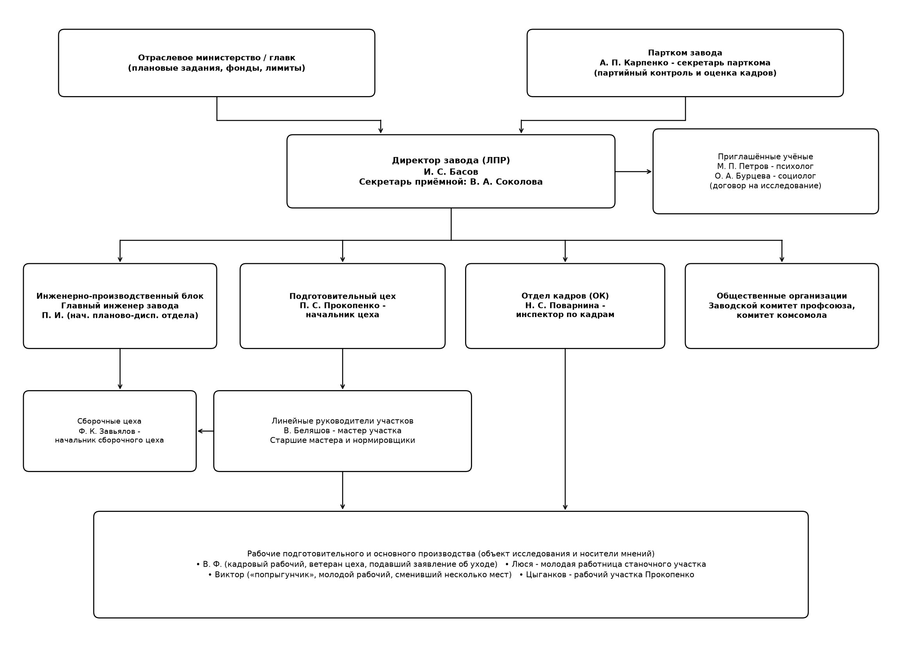
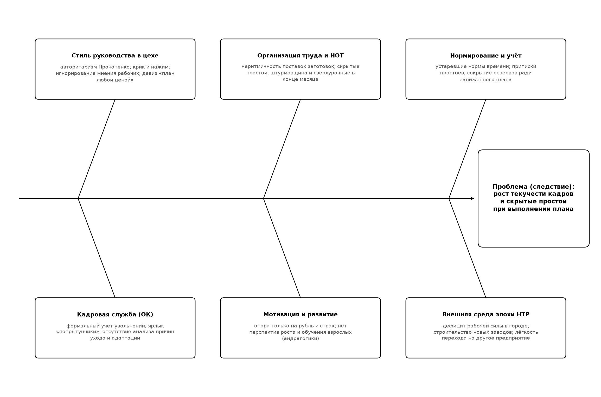

# СЕМИНАР № 6

## Кинокоучинг по фильму «Собственное мнение» (1977)

**Исполнитель:** студент группы П-41 Соловьев А. С.  
**Тема письма:** `П-41_Соловьев_АС_СМ` (`П-41_Соловьев_АС_ПЗ-06_СМ`)  
**Киноматериал:** «Собственное мнение», СССР, Мосфильм, 1977, реж. Ю. Карасик, сцен. В. Черных  
**Год выполнения:** 2026  
**Формат работы:** индивидуальный управленческий анализ для последующего коллективного обсуждения

---

## 1. Название и цель работы

**Название работы:** Кинокоучинг по художественному фильму «Собственное мнение» (1977).

**Цель работы:** применить теоретические сведения курса для управленческого анализа производственной ситуации, показанной в фильме «Собственное мнение» (1977), выявить организационные и социально-психологические проблемы промышленного предприятия, определить причины текучести кадров и скрытых простоев, оценить действия руководителей и приглашённых учёных и предложить обоснованное управленческое решение [1; 2; 3].

## 2. Организация, продукт деятельности и тип экономической системы (вопросы 1–2)

### 2.1. О какой организации идёт речь и что является продуктом её деятельности (вопрос 1)

В фильме показан крупный советский **машиностроительный (приборостроительный) завод** в промышленном городе. Предприятие является современным для конца 1970-х годов производственным комплексом с подготовительным, механическим и сборочными цехами, конструкторско-технологическими службами, планово-диспетчерским отделом, отделом кадров, заводским комитетом профсоюза и партийным комитетом (парткомом).

**Продукт деятельности организации:** серийная промышленная машиностроительная продукция (сложные узлы, агрегаты и готовые изделия, собираемые в сборочных цехах из заготовок и деталей, поступающих из подготовительного цеха). С экономической точки зрения основным результатом деятельности завода в глазах отраслевого министерства выступает **выполнение государственного производственного плана** по объёму, номенклатуре и срокам поставок.

### 2.2. Тип экономической системы эпохи фильма (вопрос 2)

Действие фильма происходит в СССР во второй половине 1970-х годов (фильм снят в 1977 г.). Для этой эпохи характерна **плановая (командно-административная, социалистическая) экономическая система**, которая определяет все условия принятия решений на заводе:

1. **Государственная собственность на средства производства и директивное планирование.** Завод не формирует свободно свой продуктовый портфель и цены: плановые задания, фонд заработной платы (ФЗП), численность персонала, нормы и лимиты спускаются сверху отраслевым министерством (главком).
2. **Приоритет валового выполнения плана («план любой ценой»).** Успешность предприятия и премии коллектива зависят от выполнения месячного, квартального и годового плана, что порождает аритмию производства, «штурмовщину» в конце месяца и стремление начальников цехов скрывать внутренние резервы, чтобы план на следующий период не увеличили.
3. **Полная занятость и дефицит квалифицированной рабочей силы.** В условиях бурного промышленного строительства в городе открываются новые предприятия, нет безработицы, а тарифные ставки на разных заводах сопоставимы. Поэтому квалифицированный рабочий легко может уволиться по собственному желанию и перейти на соседний завод, где лучше условия труда и уважительнее отношение руководства.
4. **Двойной контур управления (хозяйственный и партийно-общественный).** Наряду с единоначалием директора важнейшую роль в кадровых и социальных вопросах играют партком КПСС, профком и комитет комсомола.

## 3. Руководитель организации как лицо, принимающее решения (вопрос 3)

**Руководитель организации:** директор завода **Иван Степанович Басов**.

**Является ли он лицом, принимающим решения (ЛПР):** да, И. С. Басов является главным ЛПР на уровне предприятия, поскольку наделён правом единоначалия, распоряжается ресурсами завода в пределах плановых лимитов и несёт персональную ответственность за производственный, экономический и социальный результат работы коллектива.

**Уровень принимаемых директором решений (по классификации М. Вудкока и Д. Фрэнсиса, см. [1, с. 136–137]):**

- **в рамках планово-отчётной дисциплины перед министерством** часть его решений носит **селективный (2-й уровень)** характер: выбор способа выполнения спущенного сверху государственного плана при заданных ресурсах;
- **в ситуации, показанной в фильме**, директор выходит на **адаптационный (3-й уровень)** и элементы **инновационного (4-го уровня)**: столкнувшись с проблемой оттока квалифицированных кадров с передового завода, он не ограничивается привычным административным нажимом, а приглашает внешних учёных (психолога и социолога), инициирует научное исследование коллектива и в финале создаёт на заводе новую структурную единицу: постоянную социологическую лабораторию.

**Перед кем отвечает директор завода:**

1. **по административно-хозяйственной линии** - перед вышестоящим отраслевым органом управления (главным управлением министерства / министром), который назначает директора, утверждает план и контролирует его выполнение;
2. **по партийно-политической линии** - перед партийным комитетом завода (парткомом во главе с секретарём А. П. Карпенко) и вышестоящими партийными органами (горкомом и обкомом КПСС), поскольку директор является коммунистом и несёт партийную ответственность за морально-политический климат в коллективе;
3. **по социально-трудовой линии** - перед трудовым коллективом и профсоюзной организацией в рамках коллективного договора и трудового законодательства.

## 4. Ключевые персонажи фильма и органиграмма производственной системы (вопрос 4)

В таблице представлены 14 ключевых персонажей, задействованных в производственной ситуации фильма, с указанием их должностей и роли в системе управления.

| № | Персонаж (имя, фамилия) | Должность / статус | Роль в ситуации и взаимосвязь в производственной системе |
|---|---|---|---|
| 1 | **Басов Иван Степанович** | Директор завода | Высшее ЛПР предприятия; заказчик исследования причин текучести кадров; принимает итоговое решение по Прокопенко и созданию социологической службы |
| 2 | **Петров Михаил Петрович** | Психолог, руководитель исследовательской группы (внешний консультант) | Проводит диагностику социально-психологического климата, интервью, анализ простоев; выносит острые выводы на партком |
| 3 | **Бурцева Ольга Андреевна** | Социолог, младший научный сотрудник (помощница Петрова) | Проводит анкетирование, хронометраж с секундомером, статистическую обработку данных и наблюдение в цехах |
| 4 | **Прокопенко Павел Семёнович** | Начальник подготовительного цеха | Линейный руководитель ключевого цеха; даёт план за счёт жёсткого нажима, штурмовщины и скрытых резервов; главный объект критики в исследовании |
| 5 | **Карпенко Александр Петрович** | Секретарь парткома завода | Руководитель партийной организации предприятия; организует обсуждение предварительных итогов исследования на заседании парткома |
| 6 | **Поварнина Надежда Сергеевна** | Инспектор отдела кадров (сотрудница ОК) | Оформляет приём и увольнение работников; сводит проблему текучести к ярлыку «попрыгунчики» и формальному заполнению бумаг |
| 7 | **Беляшов Василий** | Мастер участка в подготовительном цехе | Низовой линейный руководитель, подчинённый Прокопенко; находится под постоянным давлением начальника цеха и передаёт нажим рабочим |
| 8 | **Завьялов Фёдор Казимирович** | Начальник сборочного цеха | Руководитель смежного цеха, работа которого напрямую зависит от ритмичности подачи заготовок из подготовительного цеха Прокопенко |
| 9 | **Главный инженер завода** | Первый заместитель директора по технической части | Отвечает за техническую политику, технологическую дисциплину и координацию производственных цехов |
| 10 | **Начальник ПДО (Пётр Иванович)** | Руководитель планово-диспетчерского отдела | Планирует загрузку цехов и сменные задания; заинтересован в формальном выполнении сводки |
| 11 | **Соколова Вера** | Секретарь директора завода | Обеспечивает документооборот и коммуникацию приёмной директора с руководителями служб и приглашёнными учёными |
| 12 | **Виктор (молодой рабочий)** | Рабочий завода («попрыгунчик») | Молодой рабочий, сменивший несколько мест работы в поисках призвания и уважительного отношения; объект беседы Петрова о мотивации и обучении |
| 13 | **Люся (молодая работница)** | Станочница подготовительного цеха | Работница участка, на рабочем месте которой Бурцева проводит хронометраж операций и выявляет простои из-за нехватки заготовок |
| 14 | **Кадровый рабочий-ветеран (Василий Фёдорович) и рабочий Цыганков** | Квалифицированные рабочие подготовительного цеха | Опытные производственники, недовольные криком, неритмичностью работы и неуважением со стороны Прокопенко; подают заявления об уходе |

Взаимосвязь указанных персонажей в рамках производственной и общественно-управленческой системы завода представлена на органиграмме (рисунок 1).

**Рисунок 1 - Органиграмма взаимосвязи ключевых персонажей в рамках производственной системы завода**

## 5. Причины приглашения учёных, факторы среды и понятия «цель», «задача», «проблема» (вопрос 5)

### 5.1. Для чего на завод были приглашены учёные и какие именно (вопрос 5)

По инициативе директора И. С. Басова на завод по хоздоговору были приглашены два профильных специалиста: **промышленный психолог Михаил Петрович Петров** и **социолог Ольга Андреевна Бурцева**. Цель их приглашения - провести независимое научно-практическое исследование и установить истинные причины высокой **текучести кадров**: почему с передового, технически оснащённого завода, стабильно выполняющего план и обеспечивающего хорошую зарплату, массово увольняются квалифицированные рабочие.

### 5.2. Изменение факторов среды и возникновение проблемы: SWOT-анализ и ПСД (вопрос 5a, 5b)

Ситуация на заводе возникла на пересечении изменений внешней среды (эпоха НТР, рост числа предприятий в городе, дефицит рабочих рук и возросшие запросы образованного работника к уважению и содержанию труда) и застарелых дефектов внутренней среды (авторитарный стиль управления в цехах, неритмичность производства, формальная работа отдела кадров). Комплексная оценка факторов внутренней и внешней среды представлена в таблице SWOT-анализа, а структура причин - на причинно-следственной диаграмме Исикавы (рисунок 2).

| Категория среды | Позитивные факторы (S, O) | Негативные факторы (W, T) |
|---|---|---|
| **Внутренняя среда завода** (сильные стороны **S** / слабые стороны **W**) | 1) современное предприятие, стабильно выполняющее государственный план; 2) достойный уровень оплаты труда и премирования; 3) готовность директора И. С. Басова к самокритике и привлечению науки; 4) наличие квалифицированного ядра рабочих и мастеров | 1) авторитарный, грубый стиль руководства в подготовительном цехе (П. С. Прокопенко); 2) скрытые внутрисменные простои, аритмия и «штурмовщина» в конце месяца; 3) устаревшее нормирование труда и сокрытие резервов мощности; 4) формально-бюрократическая работа отдела кадров (Н. С. Поварнина); 5) отсутствие системы адаптации и учёта мнения работников |
| **Внешняя среда эпохи НТР** (возможности **O** / угрозы **T**) | 1) развитие движения НОТ (научной организации труда) и промышленной социологии; 2) возможность создания собственной заводской социологической лаборатории; 3) повышение образовательного и культурного уровня рабочих, их готовность учиться и участвовать в рационализации производства | 1) острый дефицит рабочей силы в городе из-за открытия новых предприятий; 2) лёгкость перехода квалифицированных рабочих к предприятиям-конкурентам на рынке труда; 3) жёсткий контроль министерства за выполнением текущего плана, ограничивающий время на перестройку управления |

**Рисунок 2 - Причинно-следственная диаграмма (ПСД) проблемы текучести кадров и скрытых простоев**

### 5.3. Определения понятий «цель», «задача» и «проблема» (вопрос 5c)

В соответствии с теорией менеджмента и учебным пособием Л. И. Лукичёвой [1, с. 24–25, 138] эти три базовых понятия строго разграничиваются:

- **Цель**: это конкретное, осознанное желаемое состояние отдельных характеристик организации (ожидаемый конечный результат деятельности), достижение которого является для неё желательным и на достижение которого направлена её деятельность в установленный период времени [1, с. 24]. В фильме стратегическая цель директора: обеспечить устойчивое выполнение плана при стабильном, мотивированном трудовом коллективе и низкой текучести кадров.
- **Проблема**: это объективно возникшее противоречие (разрыв) между фактическим и желаемым состоянием объекта управления, когда способы преодоления этого разрыва заранее не очевидны и требуют выработки управленческого решения. В фильме проблема состоит в том, что внешне благополучный завод теряет квалифицированных людей, а привычные административные меры не останавливают отток.
- **Задача**: это конкретизированная часть (этап, подцель) работы, которая должна быть выполнена определённым способом в заданных условиях и сроках для разрешения проблемы и достижения поставленной цели. В фильме задачей приглашённых учёных являлось диагностировать причины увольнений и простоев и представить руководству обоснованные рекомендации.

## 6. Методы исследований учёных, секундомер и нормирование труда (вопрос 6)

В ходе работы на заводе М. П. Петров и О. А. Бурцева применили комплекс социологических, психологических и организационно-экономических методов исследования:

1. **Анализ документальных источников (кабинетное исследование):** изучение карточек увольняющихся в отделе кадров, сводок выполнения плана, графиков работы цехов, данных о сверхурочных и простоях.
2. **Анкетирование и письменный социологический опрос:** сбор массовых анонимных оценок работников об условиях труда, удовлетворённости работой, взаимоотношениях с мастерами и начальником цеха.
3. **Индивидуальные и групповые интервью (беседы):** глубинные интервью с увольняющимися рабочими, молодыми рабочими («попрыгунчиками»), мастерами (Беляшовым), начальниками цехов (Прокопенко, Завьяловым) и инспектором отдела кадров (Поварниной).
4. **Непосредственное включённое и невключённое наблюдение** за поведением руководителей на планёрках и рабочих местах.
5. **Хронометраж и фотография рабочего времени с помощью секундомера.**

**Зачем в кадре появлялся секундомер:** социолог О. А. Бурцева стояла с секундомером у станка работницы Люси и фиксировала фактические затраты времени на выполнение технологических операций и длительность пауз (внутрисменных простоев). Секундомер позволил установить объективный факт: рабочие способны выполнять операцию значительно быстрее действующей нормы, однако значительную часть смены они **вынужденно простаивают** в ожидании заготовок, инструмента или распоряжений, а затем наверстывают план за счёт аврала и сверхурочных.

**Что такое нормирование труда и для чего оно нужно:**  
**Нормирование труда** - это установление научно обоснованной меры затрат труда на изготовление единицы продукции или выполнение определённого объёма работы в конкретных организационно-технических условиях (норма времени, норма выработки, норма обслуживания, норматив численности). В управлении предприятием нормирование необходимо для:

- расчёта реальной производственной мощности цехов и участков;
- равномерного (ритмичного) календарно-планового распределения заданий без простоев и штурмовщины;
- справедливой организации сдельной и премиальной оплаты труда;
- выявления скрытых резервов роста производительности труда.

В фильме показано, что искажённое (заниженное) нормирование в цехе Прокопенко маскировало неорганизованность и позволяло списывать простои, создавая видимость перевыполнения норм.

## 7. Связь сюжета фильма с НТР и развитием направления НОТ (вопрос 7)

Сюжет фильма и принятое директором И. С. Басовым решение непосредственно отражают переход советской промышленности 1970-х годов к этапу **Научно-технической революции (НТР)** и широкому внедрению **Научной организации труда (НОТ)**:

1. **Сущность вызова НТР.** В условиях НТР заводы получили сложную, дорогостоящую технику и более образованного рабочего. Оказалось, что техническое перевооружение само по себе не даёт роста эффективности, если сохраняются старые, «донаучные» (волевые, командно-крикливые) методы управления людьми и кустарная организация смен. Человеческий фактор стал главным ограничителем эффективности техники.
2. **Роль и методы НОТ.** Научная организация труда (у истоков которой стояли Ф. Тейлор, Ф. и Л. Гилбрет, а в СССР - А. К. Гастев и П. М. Керженцев [1, с. 265]) предполагает замену работы «на глазок» строгим научным исследованием трудового процесса. В системе НОТ применяются:
   - изучение затрат рабочего времени (хронометраж, фотография и самофотография рабочего дня);
   - технически обоснованное **нормирование труда** как фундамент планирования и оплаты;
   - рациональная организация и бесперебойное обслуживание рабочих мест заготовками и инструментом;
   - улучшение санитарно-гигиенических, психофизиологических и эстетических условий труда;
   - учёт социально-психологических факторов, снижение монотонности и утомляемости, укрепление сознательной дисциплины.
3. **Связь с решением директора.** Пригласив психолога и социолога, а затем приняв решение о создании на заводе постоянной социологической лаборатории, директор Басов переводит управление предприятием на рельсы НОТ и социального планирования: решения о кадрах и производстве начинают опираться на замеры, статистику и психологию труда, а не на субъективные рапорты начальников цехов.

## 8. Причины простоев, смена оценки с «+» на «–» и «умысел» «уличённого» (вопрос 8)

**Какие причины простоев были обнаружены учёными:**  
Хронометраж и опросы показали, что внутрисменные простои рабочих в подготовительном цехе вызывались не ленью станочников, а **плохой организацией производства внутри цеха**: несвоевременной подачей заготовок и металла, несогласованностью сменных заданий, ожиданием наладки и неравномерным распределением работ в начале и середине месяца с последующим авралом («штурмовщиной») и сверхурочными в конце месяца.

**Оценка чьей работы сменила знак с «+» на «–»:**  
В результате исследования знак оценки сменился с **«+» на «–»** у **начальника подготовительного цеха Павла Семёновича Прокопенко**. До прихода учёных он считался на заводе передовым руководителем («маяком»), поскольку его цех из месяца в месяц давал свыше 100% плана. Исследование Петрова и Бурцевой показало, что с точки зрения долгосрочной эффективности завода его работа разрушительна: цех лихорадит смежные сборочные подразделения (цех Завьялова), расходует фонд сверхурочных и является главным источником увольнений квалифицированных рабочих.

**В чём состоял «умысел» «уличённого» (П. С. Прокопенко):**  
Прокопенко сознательно **скрывал реальные производственные резервы цеха и поддерживал заниженные, устаревшие нормы выработки**. Его расчёт («умысел») был типичен для плановой экономики:

1. если показать истинную производительность станков и работать ритмично без простоев, министерство и ПДО в следующем квартале увеличат цеху плановое задание («срежут расценки и поднимут план»);
2. удерживая искусственный резерв и оформляя в конце месяца сверхурочные («штурм»), Прокопенко гарантировал себе лёгкое перевыполнение заниженного плана, почёт в сводках, прогрессивку и премии, а рабочих привязывал к себе распределением выгодных «сверхурочных» нарядов;
3. всех несогласных с такой системой и с его грубым, крикливым обращением он выдавливал из цеха.

**К какой категории факторов можно отнести выявленное:**  
По классификации учебного пособия Л. И. Лукичёвой [1, с. 133–135, 211] выявленные явления относятся к **внутренним организационно-управленческим и социально-психологическим (субъективным, поведенческим) факторам**: личностным оценкам и стилю руководителя, поведенческим ограничениям, несовершенству организации и нормирования труда, а также к противоречию частных интересов подразделения общим целям предприятия.

## 9. Оценка работы сотрудницы отдела кадров и уровень её решений (вопрос 9)

**Какую оценку получила работа сотрудницы отдела кадров (Н. С. Поварниной):**  
Работа инспектора отдела кадров Надежды Сергеевны Поварниной получила у учёных **негативную (критическую) оценку**. Несмотря на внешнюю исполнительность и многолетний стаж, её деятельность оказалась чисто канцелярской и бесполезной для удержания персонала.

**В чём была ошибочность её понимания своей задачи:**  
Поварнина видела свою задачу лишь в **пассивной регистрации кадрового документооборота** («принять заявление - поставить штамп - выдать трудовую книжку - заполнить графу в отчёте»). Вместо того чтобы разбираться в истинных мотивах увольнения каждого рабочего, анализировать, из каких именно цехов бегут люди, и помогать в профориентации и адаптации новичков, она навешивала на увольняющихся удобный обвинительный ярлык - «летуны», «попрыгунчики», «за длинным рублём гонятся», тем самым снимая ответственность и с отдела кадров, и с начальников цехов.

**Какого уровня решения принимаются руководителем / сотрудником отдела кадров:**  
По классификации уровней принятия решений [1, с. 136–137]:

- в том виде, как работала Поварнина в фильме, её решения находились исключительно на **1-м: рутинном уровне** (механическое следование инструкции и оформление типовых кадровых процедур);
- между тем полноценный руководитель кадровой службы при подборе, расстановке, мотивации и удержании персонала обязан принимать решения **2-го (селективного)** и **3-го (адаптационного)** уровней: анализировать информацию о причинах текучести, отбирать подходящие альтернативы трудоустройства внутри завода и вырабатывать новые способы адаптации и закрепления работников.

## 10. «Попрыгунчики» и предложенные Петровым методы мотивации (вопрос 10)

**Кого кадровики называют «попрыгунчиками»:**  
«Попрыгунчиками» (или «летунами») работники отдела кадров пренебрежительно называли **молодых рабочих, которые за короткое время сменили несколько мест работы (профессий, цехов или предприятий)**. В фильме ярким примером такого «попрыгунчика» является молодой рабочий Виктор, которого Поварнина считает ненадёжным и безответственным человеком.

**Какое решение и какие методы мотивации «попрыгунчика» предложил М. П. Петров:**  
Психолог Петров показал, что за частой сменой работы у молодого человека стоит не корысть и не лень, а **неудовлетворённая потребность в самореализации, поиске своего призвания, интересного содержательного труда и уважительного отношения**. Вместо морализаторства и карательных мер Петров предложил применить **социально-психологические и развивающие методы мотивации** (по пирамиде потребностей А. Маслоу и двухфакторной модели Ф. Герцберга [1, с. 262–264]):

1. **Профессиональная диагностика и осознанный выбор рабочего места (ротация внутри завода):** не выгонять молодого рабочего с завода, а помочь ему подобрать участок и специальность, соответствующие его склонностям и темпераменту.
2. **Обогащение содержания труда и постановка развивающих задач:** поручить работу, требующую смекалки, ответственности и мастерства, а не монотонного механического повторения.
3. **Совмещение работы с целевым обучением и ростом квалификации:** дать перспективу повышения разряда, поступления в вечерний техникум или вуз от завода.
4. **Моральное признание и наставничество:** закрепить за уважительным мастером-наставником, поддерживать инициативу и право на собственное мнение.

## 11. Принципы андрагогики в предложениях М. П. Петрова (вопрос 11)

**Андрагогика** - это теория и практика обучения взрослых людей, основанная на том, что взрослый обучающийся (в отличие от ребёнка в педагогике) обладает жизненным и профессиональным опытом, стремится к самостоятельности, учится ради решения конкретных жизненных и производственных проблем и требует уважительного партнёрского отношения.

**Какое из предложений Петрова было направлено на соблюдение принципов андрагогики в управлении человеческими ресурсами:**

1. **Обучение и переподготовка самих руководителей (начальников цехов, мастеров) и взрослых рабочих на материале их собственной производственной практики** - через разбор реальных конфликтных ситуаций цеха, совместное обсуждение результатов социологического исследования и осознание собственных ошибок управления, а не через назидательные лекции и приказы.
2. **Отношение к рабочему (в том числе к «попрыгунчику») как к самостоятельному взрослому субъекту**, который сам принимает осознанное решение о своей профессии и обучении, когда видит практический смысл учёбы для своей работы и карьеры на заводе.
3. **Принцип безотлагательного применения знаний и опоры на опыт работника:** вовлечение рабочих и мастеров в выработку предложений по устранению простоев и улучшению организации труда на их собственном участке.

## 12. «Грехи менеджера» и нарушенные принципы управления (вопрос 12)

### 12.1. «Грехи менеджера» по Хойеру (учебник Л. И. Лукичёвой, с. 46 [1])

В учебном пособии Л. И. Лукичёвой на с. 46 приведены **13 недопустимых ошибок («грехов») менеджера**, сформулированных немецким учёным Хойером [1, с. 46]. В таблице показано, какие именно из них просматриваются у руководителей завода в фильме.

| № по с. 46 [1] | «Грех менеджера» (по Хойеру) | У кого из руководителей проявляется в фильме | В чём конкретно выражается в сюжете |
|---|---|---|---|
| 1 | **Уклонение от ответственности** | Н. С. Поварнина (ОК), отчасти А. П. Карпенко и смежники | Перекладывание вины за текучесть кадров на самих рабочих («попрыгунчики») и внешние обстоятельства |
| 2 | **Исключительная ориентация на результат** | **П. С. Прокопенко** (нач. подготовительного цеха) | Девиз «давай план любой ценой»; полное игнорирование того, какой человеческой и организационной ценой достигается сводка |
| 3 | **Препятствование росту талантов** | **П. С. Прокопенко**, **Н. С. Поварнина** | Подавление инициативных, думающих рабочих; нежелание удерживать и развивать ищущую молодёжь |
| 5 | **Расхождение слова и дела** | **П. С. Прокопенко**, отчасти руководство цехов | На словах - забота о производстве и коллективе, на деле - сокрытие резервов, штурмовщина и грубость |
| 6 | **Отсутствие индивидуального подхода к людям** | **П. С. Прокопенко**, **Н. С. Поварнина** | Одинаковый командно-крикливый тон ко всем подчинённым; штампованный подход к увольняющимся в отделе кадров |
| 7 | **Вникание в мелочи** | **П. С. Прокопенко** | Мелочная опека и дёрганье мастера В. Беляшова через голову непосредственного руководства при отсутствии системного порядка |
| 8 | **Стремление доминировать** | **П. С. Прокопенко** | Подавление подчинённых и мастера Беляшова криком, нетерпимость к возражениям и «собственному мнению» работников |
| 10 | **Склонность к поучениям** | **П. С. Прокопенко**, **Н. С. Поварнина** | Постоянные нотации рабочим и молодым сотрудникам вместо конструктивного диалога |
| 11 | **Невнимание к персоналу** | **П. С. Прокопенко**, до исследования - **И. С. Басов** | Игнорирование усталости людей от сверхурочных, бытовых и психологических причин неудовлетворённости трудом |
| 12 | **Замалчивание успехов работников** | **П. С. Прокопенко** | Приписывание успеха по выполнению плана исключительно своей «твёрдой руке», отсутствие благодарности рабочим и мастерам |
| 13 | **Манипулирование людьми** | **П. С. Прокопенко** | Использование нарядов на сверхурочные, премий и страха наказания для личного подчинения рабочих и сокрытия простоев |

Из таблицы видно, что у П. С. Прокопенко присутствуют сразу **10 из 13 «грехов менеджера» по Хойеру**, а его управленческая позиция полностью соответствует архаичной роли «Управляющий - диктатор» с девизом *«Бизнес есть бизнес, работай и не рассуждай»* (табл. I.1.1 учебника [1, с. 8]).

### 12.2. Нарушенные принципы управления по А. Файолю и современные принципы (учебник Л. И. Лукичёвой, с. 11–12 [1])

Сопоставление практики управления на заводе с классическими принципами А. Файоля и современными принципами управления по с. 11–12 учебника [1] выявило следующие нарушения:

1. **Принцип постоянства состава персонала (Файоль, п. 12, с. 11 [1]):** *«работнику нужно время для того, чтобы освоиться»* - прямо нарушен высокой текучестью кадров, которую руководство долго не замечало.
2. **Принцип инициативы (Файоль, п. 14, с. 11 [1]):** *«инициатива со стороны персонала должна быть поддержана»* - нарушен Прокопенко, который пресекает любое собственное мнение рабочих и мастера Беляшова.
3. **Принцип справедливости (Файоль, п. 11, с. 11 [1]) и принцип вознаграждения (п. 7):** нарушены неравномерной загрузкой, простоями не по вине рабочих и распределением сверхурочных в зависимости от лояльности начальнику цеха.
4. **Принцип подчинения частных интересов общему (Файоль, п. 6, с. 11 [1]):** Прокопенко ставит узкоцеховой интерес (сохранить удобный заниженный план и репутацию «передовика») выше интересов всего завода и смежных сборочных цехов (Завьялова).
5. **Принцип порядка (Файоль, п. 9, с. 11 [1]):** *«подходящий человек на надлежащем месте»* и материальный порядок - нарушены как внутрисменными простоями из-за нехватки заготовок, так и формальным подбором кадров в ОК.
6. **Принцип единения персонала / корпоративного духа (Файоль, п. 13, с. 11 [1]):** вместо сплочения коллектива путём личного контакта создаётся атмосфера страха и отчуждения.
7. **Современные принципы управления (с. 11–12 [1]):** нарушены принцип *оптимального сочетания централизации и децентрализации* (умелого сочетания единоначалия и коллегиальности), принцип *оптимальности и экономичности* и принцип *комплексности* (технические задачи решались в отрыве от социальных и психологических).

## 13. Вынесение предварительных результатов исследования на партком (вопрос 13)

### 13.1. Почему Петров обрадовался вынесению обсуждения на партком, а Бурцева отказалась принимать в этом участие

- **Почему обрадовался М. П. Петров:** Петров понимал, что если сдать отчёт тихо в кабинет директора, то неудобные выводы о методах Прокопенко могут «положить под сукно», спустить на тормозах ради спокойствия и текущей сводки. Заседание парткома: это публичная коллегиальная площадка, где присутствуют секретарь парткома, директор, начальники цехов и представители коллектива; там проблему невозможно замолчать, а руководителям придётся дать принципиальную оценку фактам.
- **Почему отказалась О. А. Бурцева:** как академический социолог (и более осторожный человек), Бурцева считала, что исследование ещё не полностью завершено, часть анкет и расчётов находится в обработке, а выносить предварительные и персонально острые выводы против влиятельного начальника цеха Прокопенко на широкое партийное собрание: значит втягиваться в открытый управленческий конфликт и рисковать профессиональной репутацией в случае, если заводское руководство встанет на защиту «передовика» Прокопенко.

### 13.2. Что такое партком, полномочия секретаря и уровень решений (вопрос 13a, 13b, 13c)

- **Что такое партком и какими полномочиями обладал секретарь парткома (13a):**  
  **Партком (партийный комитет)** - выборный руководящий орган первичной организации КПСС на крупном предприятии. Согласно Уставу КПСС, партком производственного предприятия обладал **правом контроля деятельности администрации**. **Секретарь парткома (А. П. Карпенко)** де-факто являлся вторым по влиянию лицом на заводе после директора: без согласования с парткомом не происходило назначение и смещение руководящих кадров (номенклатуры), распределение жилья и крупных поощрений; партком мог заслушать отчёт любого коммуниста-руководителя (включая начальника цеха и самого директора), объявить партийное взыскание и поставить вопрос перед министерством или горкомом партии о несоответствии руководителя занимаемой должности.
- **Уровень принятия решения по с. 136–137 учебника Л. И. Лукичёвой (13b):**  
  Вынесение системной кадровой и организационной проблемы завода на обсуждение парткома относится к **3-му - адаптационному уровню принятия решений** (по М. Вудкоку и Д. Фрэнсису [1, с. 136–137]): здесь идентифицируется скрытая проблема известного типа (текучесть кадров и порочный стиль руководства), создаётся рабочая группа и вырабатывается новое для данного завода решение путём перестройки управленческой практики и оценки руководителей.
- **К каким методам принятия решений можно отнести партком (13c):**  
  По классификации методов принятия управленческих решений партком относится к **коллективным (коллегиальным, групповым) экспертно-совещательным методам** - в форме **делового совещания / комиссии (комитета)** с элементами **пошагового разбора конфликтной ситуации (кейса)** и коллективной экспертной оценки вариантов решения [1, с. 70–73, 147–148, 156].

## 14. Решение директора Басова после парткома, притча «Дорогое обучение» и книга И. К. Адизеса (вопрос 14)

### 14.1. Какое решение принял директор и как его можно прокомментировать (вопрос 14, 14a)

В результате острого выступления Петрова на парткоме директор И. С. Басов принял **взвешенное двуединое решение**:

1. **По начальнику подготовительного цеха П. С. Прокопенко:** не увольнять и не снимать его немедленно с должности «под горячую руку», несмотря на вскрытые приписки простоев и грубый стиль руководства, а оставить работать, заставив перестроить методы управления и учиться современному руководству людьми под контролем администрации и социологов.
2. **По системе управления заводом:** создать на предприятии постоянную **заводскую социологическую лабораторию (службу)** и предложить М. П. Петрову её возглавить.

**Комментарий к решению директора (14a):** решение И. С. Басова демонстрирует зрелость руководителя высокого уровня. Простое увольнение Прокопенко было бы эффектным, но поверхностным жестом: Прокопенко - опытный производственник, досконально знающий технологию цеха, а его ошибки во многом порождены самой заводской системой оценки «только по плану». Оставив Прокопенко после публичного урока на парткоме и одновременно создав социологическую службу, директор сохраняет ценного технолога и меняет правила игры на заводе.

### 14.2. Сопоставление с притчей «Дорогое обучение» об IBM (вопрос 14b)

В притче «Дорогое обучение» (раздел «Дополнительные материалы» задания, с. 4) молодой менеджер IBM совершил ошибку, из-за которой компания потеряла 10 млн долларов, и сам пришёл с готовностью быть уволенным. Руководитель IBM ответил: *«Уволить? Мы только что потратили 10 миллионов на ваше обучение и не вправе разбрасываться такими ценными кадрами. Идите работать!»*.

**Совпадает ли логика руководителей:** **да, логика директора И. С. Басова и руководителя IBM полностью совпадает.**  
Завод уже «заплатил» высокую цену за управленческие ошибки Прокопенко (текучестью кадров, сверхурочными, конфликтами и затратами на исследование), но в результате разоблачения на парткоме Прокопенко получил мощнейший, незабываемый урок. Уволить его в этот момент - значит списать в убыток весь накопленный им производственный опыт и «оплаченное» заводом обучение, тогда как осознавший ошибку руководитель способен принести предприятию гораздо большую пользу, чем неопытный сменщик.

### 14.3. Сопоставление с главой 7 «Конструктивный конфликт» (§ 1 «Люди») книги И. К. Адизеса «Идеальный руководитель» (вопрос 14c)

В приведённом фрагменте книги И. К. Адизеса «Идеальный руководитель» (с. 141) [2] сформулированы три ключевые мысли, которые напрямую перекликаются с сюжетом фильма «Собственное мнение»:

1. **«Люди - это главный актив»: завод без людей vs завод без стен.** Адизес предлагает мысленный эксперимент: что лучше потерять - оборудование и здания или людей, умеющих работать сообща? Оборудование восстановить проще, чем коллектив профессионалов (пример послевоенной Германии и Израиля). В фильме завод Басова имел прекрасные новые корпуса и станки, но терял именно человеческий капитал - квалифицированных рабочих, чего Прокопенко не понимал, считая людей легко заменимым придатком к плану.
2. **Парадигма взаимного доверия и уважения к иному («собственному») мнению.** По Адизесу, миссия менеджмента - *«научить своих сотрудников уважать иное мнение и убедить их, что, несмотря на конфликт в краткосрочном аспекте, в долгосрочной перспективе их интересы едины»*. Само название фильма - **«Собственное мнение»** - выражает ту же идею: конфликт на парткоме вокруг доклада Петрова стал **конструктивным конфликтом**, который вскрыл проблему и запустил оздоровление атмосферы на заводе.
3. **Различие между «блестящим специалистом, не уважающим людей» и менеджером (метафора «обезьяны в клетке» и фактор процесса).** Адизес пишет, что человека, который не уважает других и разрушает доверие, нельзя ставить руководителем над людьми, даже если он технически незаменим; кроме того, одних хороших людей мало - нужен **процесс (рецепт)** выработки совместных решений. В фильме Прокопенко как раз вел себя как технократ, не уважающий подчинённых, а решение Басова направлено на выстраивание того самого **процесса** (регулярной обратной связи и социально-психологической работы), который не позволяет руководителю разрушать коллектив.

### 14.4. Собственное управленческое решение в рамках экономических и нравственно-этических принципов эпохи фильма (вопрос 14d)

Строго опираясь на реалии советского промышленного предприятия конца 1970-х годов (плановая экономика, КЗоТ РСФСР, роль парткома, профкома и соцсоревнования), я предложил бы следующее комплексное решение директора:

1. **Кадровое решение по П. С. Прокопенко:** оставить в должности начальника подготовительного цеха с испытательным сроком 6 месяцев под контролем парткома и главного инженера; направить его на курсы повышения квалификации руководящих кадров по промышленной психологии и НОТ.
2. **Реформа внутризаводского планирования и нормирования (ПДО и ОТиЗ):** провести совместно с бюро НОТ пересмотр устаревших норм времени с одновременным устранением причин простоев (график межцеховой подачи заготовок под личную ответственность ПДО), чтобы рабочие не теряли в заработке при переходе на технически обоснованные нормы.
3. **Изменение условий социалистического соревнования и премирования начальников цехов:** включить в обязательные показатели оценки работы начальника цеха (наряду с планом) **коэффициент ритмичности производства, отсутствие сверхурочных и коэффициент стабильности кадров (снижение текучести)**; при росте текучести лишать начальника цеха части премии.
4. **Перестройка работы отдела кадров:** перевести Н. С. Поварнину на чисто учётный участок, а в отделе кадров ввести общественное бюро приёма и увольнения совместно с заводской социологической лабораторией: ни одно заявление об увольнении по собственному желанию не подписывать без беседы с социологом и выяснения конкретной причины в цехе.
5. **Развитие молодёжи и наставничества:** закрепить молодых рабочих («попрыгунчиков») за авторитетными кадровыми рабочими-наставниками, связать присвоение очередного разряда и направление в заводской втуз/техникум с индивидуальным планом профессионального роста.

## 15. Связь ответа Петрова на финальное предложение директора с Теорией U и собственный выбор (вопрос 15)

**В чём состоял ответ М. П. Петрова в финале фильма:**  
Когда директор И. С. Басов предложил Петрову остаться на заводе и возглавить создаваемую социологическую лабораторию, Петров **отказался занять кресло штатного начальника лаборатории**, но порекомендовал на эту роль свою молодую коллегу О. А. Бурцеву, которая за время исследования выросла профессионально и обрела твёрдую позицию, а сам решил продолжить исследовательскую и консультационную работу.

**Как этот ответ связан с положениями Теории U (Отто Шармера):**  
Согласно **Теории U** О. Шармера, подлинное лидерство и глубинные изменения проходят по U-образной траектории:

1. **Нисходящая ветвь U (отказ от прошлых шаблонов, «отпускание» - letting go):** открытие ума (Open Mind - сбор реальных фактов без предвзятости), открытие сердца (Open Heart - эмпатия к рабочим и понимание позиции даже оппонента Прокопенко) и открытие воли (Open Will - готовность отпустить личное эго и карьерную выгоду ради сути дела).
2. **Нижняя точка U (присутствие - Presencing):** соединение со своим подлинным призванием и будущим потенциалом системы.
3. **Восходящая ветвь U («принятие и воплощение» - letting come):** кристаллизация нового решения, прототипирование (создание заводской социологической службы) и его институционализация без привязки к одному «спасителю».

Отказ Петрова от должности начальника лаборатории - это точное проявление принципа **«отпускания» (letting go) и зрелого фасилитационного лидерства по Теории U**: Петров понимает, что его призвание - быть независимым исследователем и катализатором изменений, а превратившись в штатного подчинённого директора, он неизбежно встроится в заводскую иерархию и потеряет независимость взгляда. Передав лабораторию выросшей как специалист Бурцевой, он обеспечивает устойчивое развитие новой структуры.

**Какое решение принял бы я на месте М. П. Петрова:**  
На месте М. П. Петрова я также **не стал бы переходить в постоянный административный штат завода**, но оформил бы с предприятием Басова долгосрочный договор **научного руководства и внешнего курирования** созданной социологической лаборатории (во главе с О. А. Бурцевой) на первые 1–1,5 года. Это позволило бы, с одной стороны, сохранить профессиональную независимость внешнего консультанта (которого не может административно «задавить» начальник цеха), а с другой - не бросить молодую службу на этапе внедрения рекомендаций и довести начатую перестройку до измеримого снижения текучести кадров.

## 16. Личные выводы по результатам кинокоучинга (вопрос 16a–d)

### 16.1. Чем опыт такого анализа полезен для будущей профессии и было ли интересно (вопрос 16a)

Проводить управленческий анализ художественного фильма было по-настоящему интересно, поскольку кинокоучинг позволяет увидеть «живую ткань» организации, которую невозможно почувствовать в сухих числовых таблицах: интонации планёрок, защитные реакции руководителей, страх подчинённых и скрытые мотивы решений. Для моей будущей профессиональной деятельности этот опыт полезен тем, что учит **не верить благополучным сводкам на слово**, отделять симптомы (увольнения, опоздания, конфликты) от корневых организационных причин (плохого планирования, простоев, токсичного стиля руководства) и опираться при принятии решений на объективные замеры и обратную связь от исполнителей.

### 16.2. Оправдали ли учёные связанные с ними ожидания (вопрос 16b)

**Да, учёные полностью оправдали и даже превзошли ожидания директора И. С. Басова.** Вместо удобной формальной справки, оправдывающей администрацию завода, М. П. Петров и О. А. Бурцева провели честное комплексное исследование, вскрыли реальный механизм внутрисменных простоев и штурмовщины в «передовом» цехе Прокопенко, показали несостоятельность формального подхода отдела кадров и добились того, что проблема человеческого фактора стала предметом принципиального решения руководства и парткома.

### 16.3. Кто из персонажей заинтересовал и какими характеристиками (вопрос 16c)

Наибольший интерес у меня вызвали два персонажа:

1. **Директор завода И. С. Басов** - своей управленческой смелостью, стратегическим мышлением и отсутствием самодовольства: будучи руководителем успешного по формальным показателям завода, он не побоялся впустить внешних исследователей, выслушать нелицеприятную правду на парткоме и принять дальновидное решение (сохранить и перевоспитать Прокопенко и создать социологическую службу).
2. **Психолог М. П. Петров** - сочетанием научной добросовестности, эмпатии к простым рабочим (умением разглядеть в «попрыгунчике» человека, ищущего своё дело) и гражданского мужества в отстаивании профессионального вывода перед лицом административного давления.

### 16.4. Привлекательна ли работа в коллективе, аналогичном показанному в фильме (вопрос 16d)

Работа **непосредственно в цехе под началом П. С. Прокопенко (в исходном состоянии)** для меня **непривлекательна**, поскольку крик, штурмовщина, скрытые простои и подавление инициативы разрушают профессиональное достоинство и ведут к выгоранию. Вместе с тем работа **на самом предприятии под руководством директора И. С. Басова в период начатых им преобразований** является **привлекательной**: руководитель, который ценит квалифицированных специалистов, уважает право сотрудника на собственное мнение и готов менять систему управления на научной основе, создаёт среду, в которой можно профессионально расти и приносить реальный результат.

## 17. Список использованных источников

1. Лукичёва Л. И. Управление организацией: учебное пособие по специальности «Менеджмент организации» / Л. И. Лукичёва; под ред. Ю. П. Анискина. - 3-е изд., стер. - М.: Омега-Л, 2006. - 360 с. - ISBN 5-98119-986-5. - С. 8–12, 24–25, 46–47, 133–137, 262–265.
2. Адизес И. К. Идеальный руководитель: Почему им нельзя стать и что из этого следует / Ицхак Калдерон Адизес; пер. с англ. - М.: Альпина Бизнес Букс, 2007. - 262 с. - ISBN 978-5-9614-0429-6. - С. 141.
3. Собственное мнение: художественный фильм / реж. Ю. Карасик; авт. сценария В. Черных. - СССР: Мосфильм, 1977. - 93 мин.

## Приложение А. Краткий словарь терминов для защиты

**Кинокоучинг** - метод обучения и управленческого анализа, подразумевающий разбор киноматериала не как художественного произведения, а как источника неструктурированной информации о реальных и гипотетически возможных управленческих ситуациях.

**Цель** - конкретное, осознанное желаемое состояние отдельных характеристик организации (ожидаемый результат), на достижение которого направлена деятельность в установленное время [1, с. 24].

**Проблема** - объективно возникшее противоречие (разрыв) между фактическим и желаемым состоянием объекта управления, требующее выработки решения.

**Задача** - конкретизированное действие или этап работы, который необходимо выполнить в заданных условиях и сроках для разрешения проблемы и достижения цели.

**Лицо, принимающее решение (ЛПР)** - руководитель (или коллегиальный орган), наделённый полномочиями выбора альтернативы и несущий ответственность за последствия её реализации.

**Органиграмма** - графическая схема организационной структуры управления, отражающая состав подразделений, должностных лиц, уровни иерархии и связи подчинения и взаимодействия.

**Нормирование труда** - установление научно обоснованной меры затрат труда (нормы времени, выработки, обслуживания) на выполнение работы в конкретных организационно-технических условиях.

**Хронометраж** - метод изучения затрат рабочего времени путём наблюдения и замера (с помощью секундомера) длительности повторяющихся элементов трудовой операции.

**Научная организация труда (НОТ)** - процесс совершенствования организации труда на основе достижений науки, техники и физиологии/психологии труда (рационализация рабочих мест, нормирование, условия и ритмичность труда).

**Научно-техническая революция (НТР)** - коренное качественное преобразование производительных сил на основе превращения науки в ведущий фактор производства, повышающее требования к квалификации и мотивации человека.

**Текучесть кадров** - движение рабочей силы, связанное с неплановым увольнением работников по собственному желанию или за нарушение трудовой дисциплины.

**Андрагогика** - теория и практика обучения взрослых людей с опорой на их жизненный и профессиональный опыт, самостоятельность и решение практических задач.

**Партком (партийный комитет)** - выборный руководящий орган первичной организации КПСС на предприятии в СССР, обладавший правом контроля деятельности администрации и согласования кадровых решений.

**Конструктивный конфликт (по И. К. Адизесу)** - столкновение различных мнений и точек зрения в атмосфере взаимного доверия и уважения, позволяющее выработать более качественное общее решение [2, с. 141].

**Теория U (О. Шармера)** - концепция управления изменениями и лидерства, основанная на отказе от устаревших шаблонов («отпускании»), глубинном осмыслении ситуации с открытым умом, сердцем и волей и создании нового будущего прототипа.
